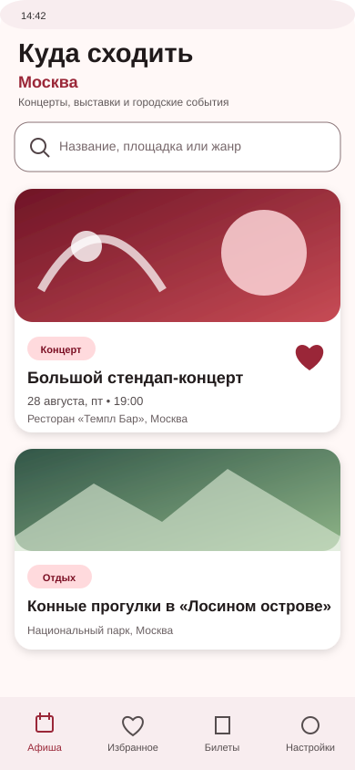
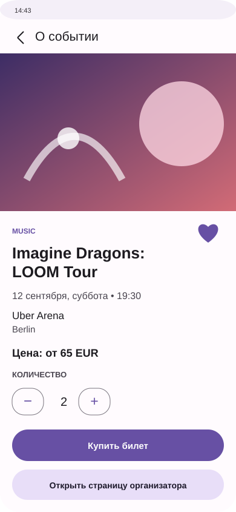

# Афиша города

Итоговый проект по Kotlin: Android-приложение с каталогом концертов, спортивных событий и других мероприятий в выбранном городе. Данные загружаются из Ticketmaster, сохраняются в Room и остаются доступны без интернета. Пользователь может искать события, добавлять их в избранное и оформлять учебные билеты.

> Покупка в проекте учебная: приложение не принимает настоящие платежи. Для реальной покупки есть переход на страницу организатора.

## Интерфейс

| Каталог и поиск | Карточка события и покупка |
|---|---|
|  |  |

## Что умеет приложение

- загружает реальные события выбранного города через Retrofit;
- сохраняет ответ API в Room и показывает данные только через `Flow` из базы;
- при ошибке сети оставляет на экране последний кэш и показывает кнопку повтора;
- ищет по названию, площадке и жанру SQL-запросом Room;
- добавляет события в избранное, не теряя флаг после обновления кэша;
- показывает отдельные списки каталога, избранного и билетов на `LazyColumn` со стабильными `key`;
- открывает детали по `eventId`, переданному через Navigation Compose;
- оформляет 1–6 учебных билетов и хранит их в связанной таблице Room;
- сохраняет город и тёмную тему в DataStore.

В навигации пять экранов: **Афиша**, **Детали**, **Избранное**, **Билеты** и **Настройки**.

## Архитектура

Проект построен на MVVM. В composable-функциях нет запросов к сети или базе: экран получает `UiState` и передаёт действия как `UiEvent` во ViewModel.


Offline-first работает так:

1. UI сразу подписывается на Room через `Flow`.
2. ViewModel запускает обновление выбранного города.
3. Repository получает ответ Ticketmaster на `Dispatchers.IO` и делает `upsert` в Room.
4. Room сам передаёт новый список на экран.
5. Если запрос завершился ошибкой, кэш остаётся видимым, а пользователь получает сообщение и `retry`.

Основные слои находятся в пакетах:

```text
data/local       Room Entity, DAO, Database
data/remote      Retrofit API и DTO
data/settings    DataStore
data             offline-first Repository
di               зависимости Hilt
ui               экраны, ViewModel, UiState и UiEvent
```

## База данных

`EventEntity` — кэш событий. Основные поля: `id` (PrimaryKey), название, изображение, дата/время, площадка, город, категория, цена, ссылка и `isFavorite`.

`TicketEntity` — оформленные билеты. Связь с событием — `ManyToOne` по `eventId`. Room-схема экспортируется в `app/schemas`.

В DAO есть:

- обычный список и избранное через `Flow`;
- `WHERE` для избранного;
- поиск через `LIKE` по трём полям;
- `UPDATE` для переключения избранного;
- добавление и удаление билета;
- `@Relation` для билета вместе с событием.

## API

Используется [Ticketmaster Discovery API](https://developer.ticketmaster.com/products-and-docs/apis/discovery-api/v2/). В проекте вызывается endpoint:

```http
GET https://app.ticketmaster.com/discovery/v2/events.json
    ?apikey=API_KEY
    &city=Berlin
    &size=50
    &sort=date,asc
```

Из ответа используются id, название, изображения, дата и время, площадка, город, жанр, диапазон цен и URL организатора.

Ограничения API: нужен бесплатный ключ разработчика; число запросов ограничивается правилами Ticketmaster; для некоторых городов или мероприятий цена может отсутствовать. В репозиторий ключ не добавляется.

## Как запустить

1. Установить Android Studio с Android SDK 35 и JDK 17.
2. Получить бесплатный Consumer Key в [Ticketmaster Developer Portal](https://developer.ticketmaster.com/).
3. В корне проекта создать или открыть `local.properties` и добавить:

   ```properties
   sdk.dir=C\:\\путь\\к\\Android\\Sdk
   TICKETMASTER_API_KEY=ваш_ключ
   ```

4. Открыть проект в Android Studio, дождаться Gradle Sync и запустить конфигурацию `app` на устройстве с Android 8.0+.

Команды для проверки из терминала Windows:

```powershell
./gradlew.bat testDebugUnitTest
./gradlew.bat assembleDebug
```

Готовый debug APK появится в `app/build/outputs/apk/debug/app-debug.apk`.

Если ключ не указан, приложение не падает: оно показывает понятную ошибку с инструкцией и кнопку повторной загрузки. Ранее загруженный кэш при этом остаётся доступен.

## Сценарии для проверки

- **Первая установка:** при наличии API-ключа появляется индикатор, затем список событий.
- **Нет сети и пустой кэш:** показывается ошибка и кнопка «Повторить».
- **Нет сети и кэш есть:** события остаются на экране, сверху показывается сообщение об ошибке.
- **Пустой поиск:** отображается отдельное состояние «Ничего не найдено».
- **Избранное:** сердечко меняется сразу, событие появляется на отдельном экране.
- **Покупка:** выбранное количество сохраняется в «Мои билеты»; запись можно удалить.
- **Смена города:** город сохраняется в настройках, после возврата в каталог нужно нажать обновление.

## Тесты

В `DetailViewModelTest` есть два unit-теста:

- клик по избранному передаёт корректный `eventId` в Repository;
- покупка передаёт количество и правильно рассчитанную сумму.

На момент последней проверки debug APK успешно собирается, оба теста проходят.

## Использованный стек

Kotlin, Jetpack Compose, Material 3, MVVM, StateFlow, Coroutines, Navigation Compose, Room, Retrofit + Gson, OkHttp, Hilt, Coil, DataStore, JUnit и Turbine.
