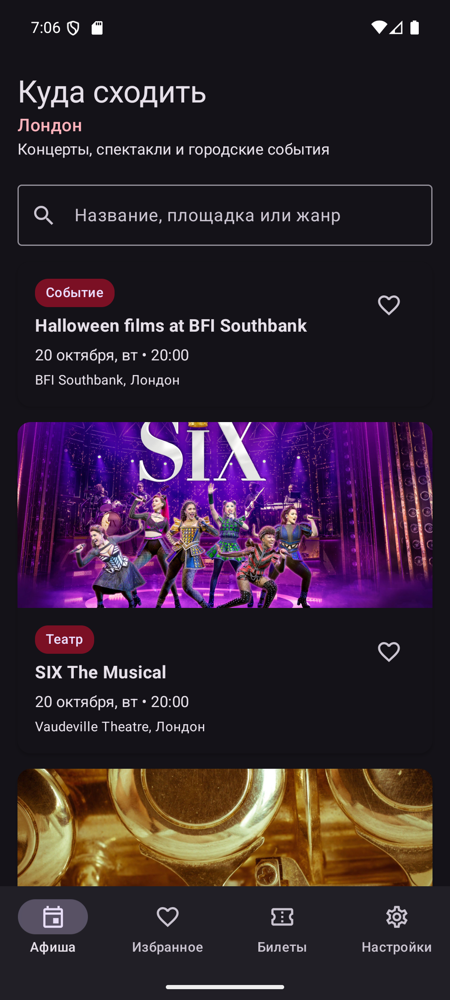
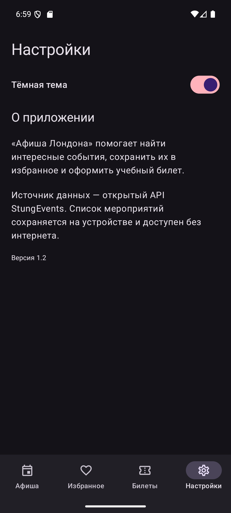
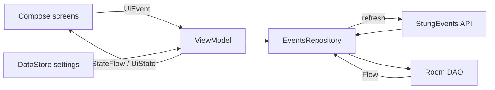

# Афиша Лондона

Итоговый проект по Kotlin: Android-приложение с каталогом концертов и других мероприятий Лондона. Данные загружаются из открытого API StungEvents, сохраняются в Room и остаются доступны без интернета. Пользователь может искать события, добавлять их в избранное и оформлять учебные билеты.

> Покупка в проекте учебная: приложение не принимает настоящие платежи. Из карточки можно открыть сайт продавца билетов, если ссылка есть в ответе API.

## Скриншоты

Снимки сделаны на эмуляторе Pixel 8.

| Афиша с событиями из API | Настройки в тёмной теме |
|---|---|
|  |  |

## Что умеет приложение

- загружает реальные события Лондона через Retrofit;
- сохраняет ответ API в Room и показывает данные только через `Flow` из базы;
- при ошибке сети оставляет на экране последний кэш и показывает кнопку повтора;
- ищет по названию, площадке и жанру SQL-запросом Room; символы `%` и `_` воспринимаются как обычный текст;
- добавляет события в избранное, не теряя флаг после обновления кэша;
- показывает отдельные списки каталога, избранного и билетов на `LazyColumn` со стабильными `key`;
- открывает детали по `eventId`, переданному через Navigation Compose;
- оформляет 1–6 учебных билетов и хранит их в связанной таблице Room;
- сохраняет выбранную тему приложения в DataStore.

В навигации пять экранов: **Афиша**, **Детали**, **Избранное**, **Билеты** и **Настройки**.

## Архитектура

Проект построен на MVVM. В composable-функциях нет запросов к сети или базе: экран получает `UiState` и передаёт действия как `UiEvent` во ViewModel.



Offline-first работает так:

1. UI сразу подписывается на Room через `Flow`.
2. ViewModel запускает обновление афиши Лондона.
3. Repository получает ответ StungEvents на `Dispatchers.IO` и делает `upsert` в Room.
4. Room сам передаёт новый список на экран.
5. Если запрос завершился ошибкой, кэш остаётся видимым, а пользователь получает сообщение и `retry`.

Основные слои находятся в пакетах:

```text
data/local       Room Entity, DAO, Database
data/remote      Retrofit API и DTO
data/settings    DataStore
data             offline-first Repository
di               зависимости Hilt
ui               экраны, ViewModel, UiState и UiEvent
```

## База данных

`EventEntity` — кэш событий. Основные поля: `id` (PrimaryKey), название, изображение, дата/время, площадка, город, категория, цена, ссылка и `isFavorite`.

`TicketEntity` — оформленные билеты. Связь с событием — `ManyToOne` по `eventId`. События обновляются через Room `@Upsert`: повторная загрузка не удаляет связанные билеты. Room-схема экспортируется в `app/schemas`.

В DAO есть:

- обычный список и избранное через `Flow`;
- `WHERE` для избранного;
- поиск через `LIKE` по трём полям;
- `UPDATE` для переключения избранного;
- добавление и удаление билета;
- `@Relation` для билета вместе с событием.

## API

Используется открытый [StungEvents API](https://docs.stungevents.com/debug/default/index) с официального сайта сервиса. Авторизация и секретный ключ для чтения событий не требуются. В проекте вызывается endpoint:

```http
GET https://api.stungevents.com/events?city=London&limit=60
```

Из ответа используются id, название, описание, изображение, дата, площадка, категория, цена и ссылка продавца билетов (`ticket_url`). Названия и описания событий приходят на языке организатора; интерфейс приложения остаётся русским.

Ограничения API: у части мероприятий не указаны точное время, площадка или цена. Приложение обрабатывает такие поля и выводит понятный текст. Лимит анонимного доступа по документации сервиса — 1000 запросов в сутки с одного IP.

На тестовом компьютере 20 октября 2026 года прямые HTTPS-запросы завершались ошибкой TLS даже для обычных сайтов. Через локальный прокси новый API возвращал события Лондона без ключа. Для проверки на этом эмуляторе использован тот же прокси; в коде приложения адрес прокси не зашит. Если сеть недоступна, ранее загруженный список остаётся в Room. Инструментальные тесты проверяют загрузку, поиск, избранное, билеты и работу кэша при ошибке сети с тестовой реализацией API.

## Как запустить

1. Установить Android Studio с Android SDK 35 и JDK 17.
2. В корне проекта создать или открыть `local.properties` и указать путь к Android SDK:

   ```properties
   sdk.dir=C\:\\путь\\к\\Android\\Sdk
   ```

3. Открыть проект в Android Studio, дождаться Gradle Sync и запустить конфигурацию `app` на устройстве с Android 8.0+.

Команды для проверки из терминала Windows:

```powershell
./gradlew.bat testDebugUnitTest
./gradlew.bat assembleDebug
./gradlew.bat connectedDebugAndroidTest
```

Готовый debug APK появится в `app/build/outputs/apk/debug/app-debug.apk`.
Для `connectedDebugAndroidTest` нужен запущенный эмулятор или подключённый телефон.

Для получения афиши нужен интернет. Если API временно недоступен, приложение показывает ошибку и кнопку повторной загрузки, а ранее загруженный кэш остаётся доступен. Если на этом компьютере снова возникает ошибка TLS, проверьте доступность HTTPS. Во время проверки эмулятор работал через уже запущенный локальный прокси на порту `10809`:

```powershell
& "$env:LOCALAPPDATA\Android\Sdk\platform-tools\adb.exe" shell settings put global http_proxy 10.0.2.2:10809
```

`10.0.2.2` — адрес компьютера для Android Emulator; команда полезна только при работающем прокси на указанном порту. На обычной сети без прокси она не нужна.

## Сценарии для проверки

- **Первая установка:** появляется индикатор, затем список актуальных событий Лондона.
- **Нет сети и пустой кэш:** показывается ошибка и кнопка «Повторить».
- **Нет сети и кэш есть:** события остаются на экране, сверху показывается сообщение об ошибке.
- **Пустой поиск:** отображается отдельное состояние «Ничего не найдено».
- **Избранное:** сердечко меняется сразу, событие появляется на отдельном экране.
- **Покупка:** выбранное количество сохраняется в «Мои билеты»; запись можно удалить.
- **Тёмная тема:** выбор сохраняется через DataStore и применяется после перезапуска.

## Тесты

В `DetailViewModelTest` есть два unit-теста:

- клик по избранному передаёт корректный `eventId` в Repository;
- покупка передаёт количество и правильно рассчитанную сумму.

В `EventDaoTest` есть два инструментальных теста на Android: сохранность билета после обновления события и полный цикл обновления кэша, поиска, избранного и билетов при последующей ошибке сети.

После смены API debug APK успешно собран, установлен и открыт на эмуляторе Pixel 8 (API 36); карточки событий загрузились из сети. Автоматические тесты после этой замены ещё нужно повторно прогнать в Android Studio.

## Использованный стек

Kotlin, Jetpack Compose, Material 3, MVVM, StateFlow, Coroutines, Navigation Compose, Room, Retrofit + Gson, OkHttp, Hilt, Coil, DataStore, JUnit и Turbine.
